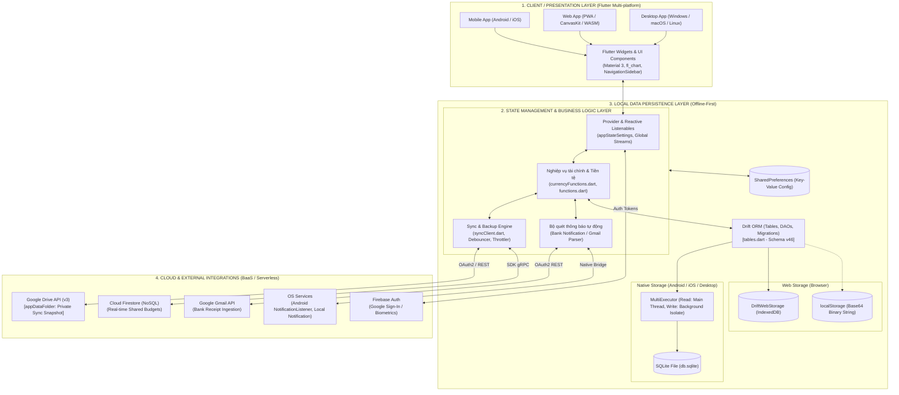
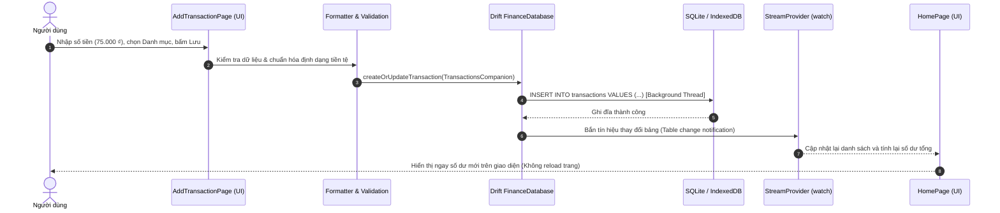
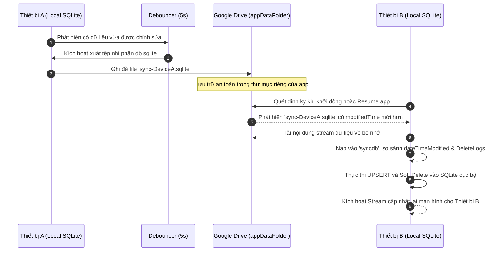
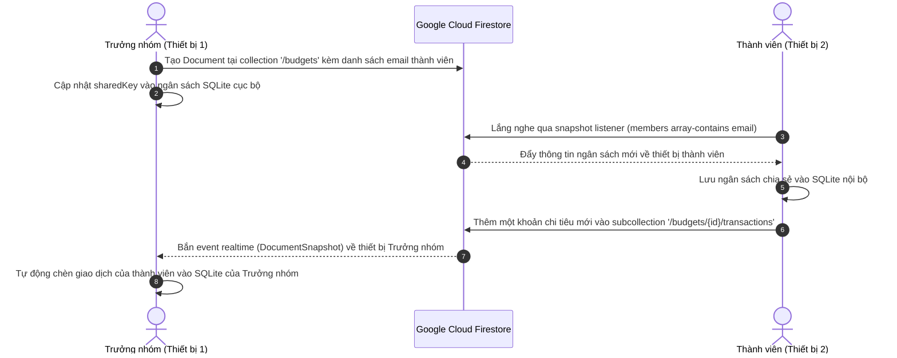
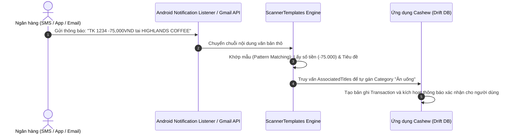
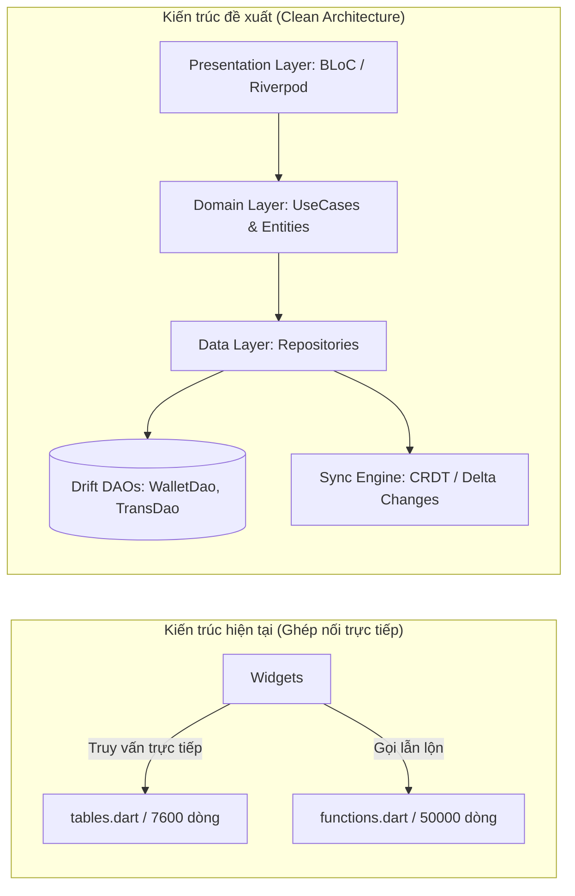

# BÁO CÁO PHÂN TÍCH KIẾN TRÚC HỆ THỐNG ỨNG DỤNG CASHEW

- **Dự án**: Ứng dụng Quản lý Chi tiêu Cá nhân Cashew
- **Nền tảng**: Flutter (Android, iOS, Web, Desktop)
- **Tài liệu tham chiếu mã nguồn**: [LoudlyDawn2108/Cashew](https://github.com/LoudlyDawn2108/Cashew)
- **Ngày lập báo cáo**: 28/09/2026

---

## MỤC LỤC
1. [Sơ đồ kiến trúc tổng thể](#1-sơ-đồ-kiến-trúc-tổng-thể)
2. [Phân tích chi tiết các thành phần CNTT](#2-phân-tích-chi-tiết-các-thành-phần-cntt)
   - 2.1. Frontend & Presentation Layer
   - 2.2. State Management & Logic tầng ứng dụng
   - 2.3. Backend & Cloud Services (Kiến trúc Serverless BaaS)
   - 2.4. API Gateway & Giao thức kết nối
   - 2.5. Tích hợp phần cứng và dịch vụ hệ điều hành
3. [Đánh giá giải pháp lưu trữ dữ liệu](#3-đánh-giá-giải-pháp-lưu-trữ-dữ-liệu)
   - 3.1. Các loại cơ sở dữ liệu sử dụng
   - 3.2. Cấu trúc lưu trữ & Thiết kế Schema
   - 3.3. Chiến lược Backup & Đồng bộ hóa dữ liệu
4. [Mô tả luồng dữ liệu (End-to-End Data Flows)](#4-mô-tả-luồng-dữ-liệu-end-to-end-data-flows)
   - 4.1. Luồng ghi nhận giao dịch cục bộ (Local CRUD Flow)
   - 4.2. Luồng đồng bộ hóa phân tán đa thiết bị qua Google Drive
   - 4.3. Luồng chia sẻ ngân sách nhóm qua Cloud Firestore
   - 4.4. Luồng trích xuất tự động từ SMS/Email ngân hàng
5. [Tổng kết và đề xuất cải tiến kiến trúc](#5-tổng-kết-và-đề-xuất-cải-tiến-kiến-trúc)
   - 5.1. Ưu điểm nổi bật
   - 5.2. Các điểm nghẽn & Hạn chế kỹ thuật
   - 5.3. Đề xuất kiến trúc cải tiến (Clean Architecture & Log-based Sync)

---

## 1. Sơ đồ kiến trúc tổng thể

Cashew được xây dựng theo mô hình **Local-First Architecture** (ưu tiên dữ liệu trên thiết bị, chạy độc lập hoàn toàn mà không bắt buộc có kết nối Internet) phối hợp cùng mô hình **Serverless BaaS (Backend-as-a-Service)** trên nền tảng Google Cloud & Firebase.



---

## 2. Phân tích chi tiết các thành phần CNTT

### 2.1. Frontend & Presentation Layer
* **Framework**: [Flutter SDK](https://flutter.dev) (ngôn ngữ Dart $\ge 3.0.0$). Toàn bộ ứng dụng chia sẻ hơn 95% mã nguồn giữa Android, iOS, Web và Desktop.
* **Hệ thống Design & Giao diện người dùng**:
  * Chuẩn **Material Design 3**, hỗ trợ chuyển đổi chủ đề động (Light Theme, Dark Theme, Pure Black AMOLED, tự đổi accent color theo sở thích).
  * Responsive thích ứng kích thước màn hình: Sử dụng `NavigationSidebar` ở chế độ màn hình lớn (Desktop, Web, Tablet) và chuyển sang `BottomNavigationBar` trên điện thoại di động.
  * Hiển thị trực quan dữ liệu tài chính qua thư viện `fl_chart: ^0.68.0`: Biểu đồ bánh phân bổ chi tiêu, đồ thị đường xu hướng biến động số dư theo tuần/tháng/năm.
* **Bản địa hóa & Tích hợp tiền tệ**:
  * Hỗ trợ đa ngôn ngữ qua `easy_localization`. Mã nguồn tùy biến đã đặt mặc định ngôn ngữ Tiếng Việt (`vi`).
  * Định dạng tiền tệ chuyên sâu: Hệ thống cấu hình số thập phân linh hoạt (`decimals = 0` đối với VNĐ `₫` và `decimals = 2` đối với USD `$`), kèm thuật toán nhận diện và chuyển đổi tỷ giá giữa các loại tiền.

### 2.2. State Management & Logic tầng ứng dụng
* **State Management**:
  * Sử dụng thư viện `provider: ^6.1.2` kết hợp cơ chế `ValueNotifier` và `ChangeNotifier` để quản lý các trạng thái toàn cục như `appStateSettings`, cấu hình người dùng, chế độ theme.
  * Tận dụng cơ chế **Reactive Streams** của Drift ORM: Các câu truy vấn dữ liệu được đóng gói thành các Stream (`watchAllTransactions()`, `watchAllWallets()`). Khi có bất kỳ bản ghi nào được ghi/sửa/xóa, Drift tự động phát tín hiệu cập nhật đến UI qua `StreamBuilder` mà không cần gọi `setState()` phân tán.
* **Điều phối & Tối ưu hiệu năng**:
  * `Debouncer`: Hoãn các tác vụ nặng (như tự động sao lưu sau khi hoàn tất sửa đổi 5 giây) để tránh tình trạng ghi file liên tục.
  * `Throttler`: Chống lặp tác vụ khi người dùng chạm liên tục vào nút bấm.

### 2.3. Backend & Cloud Services (Kiến trúc Serverless BaaS)
Cashew không vận hành backend truyền thống (không dựng container Docker Node.js/Go/Java riêng biệt), mà ủy thác cho các dịch vụ đám mây không máy chủ (Serverless BaaS):
1. **Google Firebase Authentication**: Xác thực định danh người dùng qua OAuth2 Google Sign-In hoặc chế độ ẩn danh (Anonymous).
2. **Google Cloud Firestore (NoSQL Document DB)**:
   * Chuyên phục vụ tính năng **Shared Budgets** (ngân sách dùng chung).
   * Phân cấp tài liệu: `/budgets/{budgetId}` lưu thông tin ngân sách chung và `/budgets/{budgetId}/transactions/{transId}` lưu chi tiết các giao dịch do các thành viên đóng góp.
   * Đồng bộ hai chiều thời gian thực qua kênh gRPC/WebSocket của Firebase SDK.
3. **Google Drive API (v3)**:
   * Tận dụng phân vùng ẩn đặc quyền `appDataFolder`. Đây là thư mục chỉ riêng ứng dụng Cashew có quyền truy xuất, bảo vệ sự riêng tư tuyệt đối cho người dùng.
4. **Google Gmail API**:
   * Hỗ trợ người dùng cấp quyền đọc email nhận thông báo từ ngân hàng để bóc tách giao dịch tự động.

### 2.4. API Gateway & Giao thức kết nối
* **Không tồn tại API Gateway tập trung**: Ứng dụng giao tiếp ngang hàng trực tiếp từ Client đến các API endpoint của Google Cloud thông qua bộ thư viện `googleapis: ^13.1.0` và Firebase SDK.
* **Bảo mật kênh truyền**: 100% dữ liệu trao đổi qua giao thức TLS 1.3 / HTTPS. Token OAuth2 được cấp phát và làm mới (Refresh Token) tự động bởi Google Identity Services.
* **Máy chủ phục vụ Web cục bộ (`serve.py`)**:
  * Tích hợp script máy chủ HTTP tùy biến bằng Python hỗ trợ header `Cross-Origin-Opener-Policy: same-origin` và `Cross-Origin-Embedder-Policy: require-corp` giúp kích hoạt luồng WebAssembly CanvasKit mượt mà trên trình duyệt.

### 2.5. Tích hợp phần cứng và dịch vụ hệ điều hành
* **Dịch vụ lắng nghe thông báo Android (`notification_listener_service`)**: Bắt trực tiếp thông báo biến động số dư từ các app ngân hàng (Vietcombank, MB Bank, Techcombank,...) và bóc tách nội dung theo mẫu regex định sẵn.
* **Xác thực sinh trắc học (`local_auth`)**: Hỗ trợ mở khóa ứng dụng bằng vân tay hoặc nhận diện khuôn mặt (FaceID / Fingerprint).
* **Thông báo cục bộ (`flutter_local_notifications`)**: Đặt lịch nhắc nhở các khoản chi phí định kỳ, hóa đơn sắp tới hạn và báo cáo tổng kết chi tiêu định kỳ.

---

## 3. Đánh giá giải pháp lưu trữ dữ liệu

### 3.1. Các loại cơ sở dữ liệu sử dụng

| Nền tảng / Thành phần | Công nghệ DB | Đặc điểm kỹ thuật | Đánh giá |
| :--- | :--- | :--- | :--- |
| **Android / iOS / Desktop** | **SQLite** qua Drift ORM | Cơ chế `MultiExecutor`: Truy vấn đọc chạy tại foreground; lệnh ghi chạy trên Isolate nền (`NativeDatabase.createInBackground`). | **Rất xuất sắc**: Đảm bảo toàn vẹn dữ liệu (ACID), truy vấn mili-giây, không gây giật lag giao diện (zero UI stutter). |
| **Web Browser** | **IndexedDB** / **localStorage** | Sử dụng `DriftWebStorage.indexedDbIfSupported`. Hỗ trợ fallback sang mã hóa chuỗi nhị phân trong `localStorage`. | **Tốt**: Duy trì trải nghiệm ngoại tuyến hoàn chỉnh trên PWA mà không cần gọi API máy chủ. |
| **Cloud (Shared)** | **Cloud Firestore** | Cơ sở dữ liệu tài liệu NoSQL phân tán toàn cầu, đồng bộ hóa thời gian thực. | **Phù hợp**: Tối ưu cho mô hình cộng tác ngân sách nhóm linh hoạt theo thời gian thực. |
| **Cấu hình & Flags** | **SharedPreferences** | Lưu trữ dạng Key-Value (XML trên Android, Plist trên iOS). | Truy xuất nhanh cấu hình giao diện, cờ đồng bộ và timestamp kiểm tra phiên bản. |

### 3.2. Cấu trúc lưu trữ & Thiết kế Schema

Cơ sở dữ liệu của Cashew được quản lý phiên bản chặt chẽ qua biến `schemaVersionGlobal = 46` với các thực thể cốt lõi:

* **`Wallets` (Tài khoản / Ví)**: Lưu trữ thông tin ví tiền (`walletPk` - UUIDv4), tên ví, màu sắc, biểu tượng, loại tiền tệ (`currency`), số chữ số thập phân (`decimals`), thứ tự hiển thị (`order`).
* **`Transactions` (Giao dịch)**: Bảng quan trọng nhất chứa thông tin chi tiêu/thu nhập, số tiền (`amount`), ghi chú, ngày tạo (`dateCreated`), ngày chỉnh sửa (`dateTimeModified`), liên kết khóa ngoại với Ví (`walletFk`), Danh mục (`categoryFk`), Mục tiêu (`objectiveFk`). Đồng thời hỗ trợ các cờ giao dịch định kỳ (`reoccurrence`), nợ/cho vay (`credit/debt`), và trạng thái đồng bộ (`sharedKey`, `sharedStatus`).
* **`Categories` & `CategoryBudgetLimits`**: Danh mục chi tiêu theo cây phân cấp (cha/con), màu sắc, icon, và bảng giới hạn ngân sách chi tiêu cho từng danh mục riêng lẻ.
* **`Budgets`**: Định nghĩa ngân sách chi tiêu theo chu kỳ (tuần, tháng, năm hoặc tùy chỉnh), hạn mức trần, và danh sách bộ lọc giao dịch được tính vào ngân sách.
* **`Objectives`**: Lưu trữ mục tiêu tiết kiệm tích lũy hoặc lộ trình trả các khoản nợ vay.
* **`AssociatedTitles`**: Quy tắc tự động gán danh mục dựa trên từ khóa trong tiêu đề giao dịch.
* **`ScannerTemplates`**: Lưu trữ các biểu thức chính quy (Regex) dùng để phân tích tin nhắn và email ngân hàng.
* **`DeleteLogs` (Bảng lưu vết xóa - Tombstone)**: Ghi lại mã `entryPk`, loại đối tượng và mốc thời gian xóa `dateTimeModified`, đóng vai trò mấu chốt để đồng bộ hóa việc xóa dữ liệu giữa các thiết bị ngoại tuyến.

### 3.3. Chiến lược Backup & Đồng bộ hóa dữ liệu

1. **Sao lưu & Khôi phục thủ công**:
   * Cho phép xuất toàn bộ cơ sở dữ liệu nhị phân `db.sqlite` ra tệp tin để lưu trữ ngoại vi hoặc chuyển đổi thiết bị.
   * Hỗ trợ xuất/nhập tệp **CSV** tương thích với bảng tính Excel, Google Sheets, có bộ xử lý map trường thông minh khi nhập liệu.
2. **Đồng bộ hóa đám mây ngầm qua Google Drive (Peer-to-Peer Cloud Sync)**:
   * Mỗi thiết bị khi cài đặt được cấp một mã định danh duy nhất (`clientID`).
   * Khi phát sinh thay đổi, thiết bị tự tạo bản chụp DB và tải lên Google Drive `appDataFolder` với tên `sync-{clientID}.sqlite`.
   * **Thuật toán hòa giải xung đột (Conflict Resolution)**:
     * Thiết bị tải bản backup của các thiết bị khác về một DB tạm (`syncdb`).
     * Đối soát các bản ghi dựa trên trường mốc thời gian `dateTimeModified` và danh sách xóa trong `DeleteLogs`.
     * Áp dụng nguyên tắc **Last-Write-Wins (LWW)** để hợp nhất (merge) dữ liệu vào SQLite cục bộ mà không làm mất mát thông tin của người dùng.

---

## 4. Mô tả luồng dữ liệu (End-to-End Data Flows)

### 4.1. Luồng ghi nhận giao dịch cục bộ (Local CRUD Flow)


### 4.2. Luồng đồng bộ hóa phân tán đa thiết bị qua Google Drive


### 4.3. Luồng chia sẻ ngân sách nhóm qua Cloud Firestore


### 4.4. Luồng trích xuất tự động từ SMS/Email ngân hàng


---

## 5. Tổng kết và đề xuất cải tiến kiến trúc

### 5.1. Ưu điểm nổi bật
1. **Bảo mật và Quyền riêng tư tuyệt đối (Privacy-First)**: Người dùng sở hữu toàn bộ dữ liệu tài chính của mình trên thiết bị và kho lưu trữ Google Drive cá nhân, không có máy chủ trung gian nào của nhà phát triển thu thập thông tin tài chính nhạy cảm.
2. **Khả năng hoạt động ngoại tuyến (Offline-First)**: Ứng dụng chạy mượt mà ngay cả khi không có mạng; mọi thao tác thêm/sửa/xóa đều diễn ra tức thì với độ trễ gần bằng 0.
3. **Chi phí hạ tầng bằng 0 (Zero Infrastructure Cost)**: Tận dụng hoàn toàn hệ sinh thái miễn phí của Google (Google Drive AppData, Firebase Spark tier), giúp dự án vận hành bền vững không phụ thuộc chi phí server định kỳ.

### 5.2. Các điểm nghẽn & Hạn chế kỹ thuật
1. **Hiện tượng Fat God-Files trong mã nguồn**:
   * File `budget/lib/database/tables.dart` có dung lượng lên đến hơn **7.600 dòng code**, tích hợp lẫn lộn giữa định nghĩa bảng, ORM, các câu truy vấn phức tạp, bộ lọc và thuật toán tính toán số dư.
   * File `budget/lib/functions.dart` chứa gần **50.000 dòng code** tiện ích dùng chung, gây khó khăn cho việc viết Unit Test và bảo trì.
2. **Đồng bộ hóa bằng toàn bộ tệp Snapshot (Full DB Snapshot Sync)**:
   * Việc tải lên và tải về nguyên cả tệp database SQLite qua Google Drive để hòa giải dữ liệu sẽ tốn nhiều băng thông mạng và pin thiết bị khi tệp tin phình to theo thời gian sử dụng.
3. **Nguy cơ sai lệch xung đột (Timestamp Drift)**:
   * Thuật toán Last-Write-Wins (LWW) phụ thuộc vào đồng hồ hệ thống (`dateTimeModified`). Nếu đồng hồ giữa hai máy bị lệch, giao dịch mới có thể bị đè nhầm bởi dữ liệu cũ hơn.

### 5.3. Đề xuất kiến trúc cải tiến (Clean Architecture & Log-based Sync)



1. **Tái cấu trúc mã nguồn theo Clean Architecture**:
   * **Presentation Layer**: Sử dụng **BLoC** (Business Logic Component) hoặc **Riverpod** nhằm tách rời triệt để logic tính toán ra khỏi giao diện Widget.
   * **Domain Layer**: Định nghĩa các UseCase nghiệp vụ độc lập (`AddTransactionUseCase`, `CalculateBudgetSummaryUseCase`, `CurrencyConvertUseCase`).
   * **Data Layer**: Tách `tables.dart` thành các Data Access Object (DAO) nhỏ gọn: `WalletDao`, `TransactionDao`, `BudgetDao`, `CategoryDao`.
2. **Chuyển dịch sang cơ chế đồng bộ Log-Based Sync / CRDT**:
   * Thay vì sao chép toàn bộ tệp SQLite nhị phân, chỉ ghi nhận và truyền tải **Nhật ký thay đổi (Change Deltas / Event Sourcing)** phát sinh kể từ lần đồng bộ trước.
   * Áp dụng cấu trúc dữ liệu **CRDT (Conflict-free Replicated Data Types)** hoặc giải pháp mã nguồn mở chuyên dụng cho Offline-First như **PowerSync** / **WatermelonDB Sync Engine** để tự động giải quyết xung đột mà không cần đồng bộ đồng hồ hệ thống.
3. **Tối ưu hóa chỉ mục (Indexing) và phân trang**:
   * Khai báo bổ sung các Index rõ ràng trong schema Drift cho các cột hay dùng trong mệnh đề WHERE/ORDER BY:
     ```dart
     @TableIndex(name: 'trans_wallet_date', columns: {#walletFk, #dateCreated})
     @TableIndex(name: 'trans_category', columns: {#categoryFk})
     @TableIndex(name: 'trans_modified', columns: {#dateTimeModified})
     ```
   * Bổ sung cơ chế phân trang ảo (Virtual Pagination / Infinite Scroll) trên danh sách giao dịch để giảm thiểu tối đa RAM tiêu thụ khi số lượng bản ghi đạt hàng chục ngàn.
