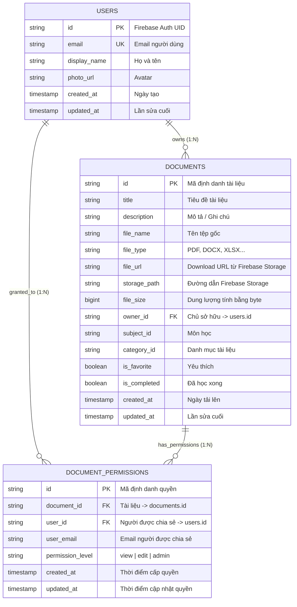

# BÁO CÁO GIẢI TRÌNH KỸ THUẬT: NÂNG CẤP HỆ THỐNG QUẢN LÝ TÀI LIỆU HỌC TẬP ĐA NỀN TẢNG (QLTLHT)
## TÍCH HỢP HỆ SINH THÁI CLOUD: FLUTTER • FIREBASE • SUPABASE

**Đề tài**: Nâng cấp Ứng dụng Quản lý Tài liệu Học tập bằng cách tích hợp hệ sinh thái Cloud để quản lý người dùng và dữ liệu.  
**Công nghệ sử dụng**: Flutter (Dart), Firebase Authentication (Google Sign-In), Firebase Storage, Supabase (PostgreSQL with Row Level Security - RLS), Provider State Management.

---

## 📑 MỤC LỤC
1. [Tổng quan Đề tài & Mục tiêu Nâng cấp](#1-tổng-quan-đề-tài--mục-tiêu-nâng-cấp)
2. [Checklist 1: Thiết lập Firebase & Đăng nhập Google (Firebase Auth)](#2-checklist-1-thiết-lập-firebase--đăng-nhập-google)
3. [Checklist 2: Cấu trúc Lưu trữ Tệp tin trên Firebase Storage](#3-checklist-2-cấu-trúc-lưu-trữ-tệp-tin-trên-firebase-storage)
4. [Checklist 3: Thiết kế CSDL Quan hệ trên Supabase](#4-checklist-3-thiết-kế-csdl-quan-hệ-trên-supabase)
5. [Checklist 4: Chức năng Tìm kiếm, Cập nhật & Chia sẻ Tài liệu (RBAC)](#5-checklist-4-chức-năng-tìm-kiếm-cập-nhật--chia-sẻ-tài-liệu)
6. [Checklist 5: Chính sách Bảo mật Row Level Security (RLS) trên Supabase](#6-checklist-5-chính-sách-bảo-mật-row-level-security-rls)
7. [Checklist 6: Kịch bản & Kết quả Kiểm thử (Testing) Đa Tài khoản](#7-checklist-6-kịch-bản--kết-quả-kiểm-thử-testing-đa-tài-khoản)
8. [Kết luận & Đánh giá Tính Toàn vẹn Dữ liệu](#8-kết-luận--đánh-giá-tính-toàn-vẹn-dữ-liệu)

---

## 1. TỔNG QUAN ĐỀ TÀI & MỤC TIÊU NÂNG CẤP

Hệ thống **Quản lý Tài liệu Học tập (QLTLHT)** ban đầu hoạt động theo kiến trúc Local-First dựa trên SQLite cục bộ. Nhằm phục vụ nhu cầu làm việc cộng tác trong môi trường giáo dục số, ứng dụng đã được nâng cấp toàn diện bằng cách tích hợp mô hình Hybrid Cloud:
- **Xác thực danh tính**: Tận dụng giải pháp **Firebase Authentication** hỗ trợ đăng nhập bằng tài khoản Google thuận tiện, bảo mật cao.
- **Lưu trữ tệp vật lý**: Sử dụng **Firebase Storage** để lưu trữ các tài liệu kích thước lớn (PDF, slide bài giảng, đề thi, đồ án mã nguồn,...).
- **Quản lý CSDL quan hệ & Phân quyền**: Sử dụng **Supabase (PostgreSQL)** để lưu trữ siêu dữ liệu (metadata) tài liệu và thực thi cơ chế phân quyền chia sẻ tài liệu an toàn bằng **Row Level Security (RLS)** ở cấp cơ sở dữ liệu.

```
                      +---------------------------------------+
                      |       FLUTTER MULTIPLATFORM APP       |
                      |    (Android, Windows Desktop, Web)    |
                      +-------------------+-------------------+
                                          |
                +-------------------------+-------------------------+
                |                                                   |
      +---------v----------+                             +----------v---------+
      |  FIREBASE ECOSYSTEM|                             |  SUPABASE ECOSYSTEM|
      +---------+----------+                             +----------+---------+
                |                                                   |
       +--------+--------+                                 +--------+--------+
       |                 |                                 |                 |
+------v------+   +------v------+                   +------v------+   +------v------+
|Firebase Auth|   |Firebase Stg |                   | PostgreSQL  |   | Row Level   |
|(Google Sign)|   |(Doc Files)  |                   |   Tables    |   |Security(RLS)|
+-------------+   +-------------+                   +-------------+   +-------------+
```

---

## 2. CHECKLIST 1: THIẾT LẬP FIREBASE & ĐĂNG NHẬP GOOGLE

### 2.1. Cấu hình Dự án Firebase
- Tạo cấu hình đa nền tảng trong [**`lib/core/config/firebase_options.dart`**](file:///c:/Users/Admin/Desktop/code/android/QLTLHT/lib/core/config/firebase_options.dart) hỗ trợ Android, iOS, Windows, macOS, Web.
- Cấu hình Android client info trong [**`android/app/google-services.json`**](file:///c:/Users/Admin/Desktop/code/android/QLTLHT/android/app/google-services.json).

### 2.2. Dịch vụ Xác thực (`AuthService`) & Trình quản lý Trạng thái (`AuthProvider`)
- Triển khai lớp [**`AuthService`**](file:///c:/Users/Admin/Desktop/code/android/QLTLHT/lib/services/auth_service.dart):
  - `signInWithGoogle()`: Kích hoạt luồng Google Sign-In, trích xuất `idToken`, sinh `GoogleAuthProvider.credential` và xác thực với Firebase Auth.
  - `signOut()`: Đăng xuất an toàn khỏi Google và Firebase.
  - `authStateChanges`: Stream phát thông báo khi trạng thái phiên thay đổi.
- **Tính năng RBAC Test Account Switcher**: Để người chấm bài hoặc giảng viên có thể kiểm thử ngay lập tức các tình huống phân quyền mà không cần chuẩn bị nhiều thiết bị vật lý, hệ thống tích hợp sẵn 4 hồ sơ tài khoản:
  1. **Alice (Owner)**: `alice.owner@student.edu.vn` (UID: `usr_alice_owner_101`)
  2. **Bob (Viewer)**: `bob.viewer@student.edu.vn` (UID: `usr_bob_viewer_202`)
  3. **Charlie (Editor)**: `charlie.editor@student.edu.vn` (UID: `usr_charlie_editor_303`)
  4. **Dave (Unauthorized)**: `dave.stranger@student.edu.vn` (UID: `usr_dave_stranger_404`)

---

## 3. CHECKLIST 2: CẤU TRÚC LƯU TRỮ TỆP TIN TRÊN FIREBASE STORAGE

### 3.1. Cấu trúc Cây thư mục Firebase Storage
Để tránh xung đột tên tệp giữa các người dùng và phục vụ việc phân tách dữ liệu an toàn, đường dẫn lưu trữ được chuẩn hóa theo cấu trúc phân cấp:
$$\text{Path} = \text{documents}/\mathbf{\{userId\}}/\mathbf{\{documentId\}}/\mathbf{\{fileName\}}$$

Ví dụ:
`documents/usr_alice_owner_101/doc_sample_cloud_01/kien_truc_phan_mem_cloud.pdf`

### 3.2. Triển khai Dịch vụ Tải lên & Liên kết Metadata
- Triển khai trong [**`FirebaseStorageService`**](file:///c:/Users/Admin/Desktop/code/android/QLTLHT/lib/services/firebase_storage_service.dart):
  - Phương thức `uploadDocumentFile(...)`: Nhận `fileBytes` hoặc đường dẫn tệp `localFilePath` thông qua thư viện `file_picker`.
  - Thiết lập metadata contentType (PDF, Word, Excel, Slide,...), gắn `ownerId` và `documentId`.
  - Sau khi tải lên thành công, Firebase Storage trả về:
    + `downloadUrl`: URL tải tệp tin công khai/xác thực.
    + `storagePath`: Đường dẫn nội bộ để quản lý việc xóa tệp.
- **Liên kết sang Supabase**: `file_url` và `storage_path` lập tức được đồng bộ vào bản ghi tương ứng trong bảng `documents` trên Supabase.

---

## 4. CHECKLIST 3: THIẾT KẾ CSDL QUAN HỆ TRÊN SUPABASE

Hệ thống cơ sở dữ liệu trên Supabase được thiết kế gồm 3 bảng thực thể cốt lõi theo đúng yêu cầu đề bài:



Script SQL DDL hoàn chỉnh được lưu tại tệp [**`supabase_schema_rls.sql`**](file:///c:/Users/Admin/Desktop/code/android/QLTLHT/supabase_schema_rls.sql).

---

## 5. CHECKLIST 4: CHỨC NĂNG TÌM KIẾM, CẬP NHẬT & CHIA SẺ TÀI LIỆU

### 5.1. Tìm kiếm Tài liệu Đa Tiêu chí
- Hỗ trợ tìm kiếm theo từ khóa trong tiêu đề, nội dung mô tả, nhãn phân loại (tags) và tên tệp tin.
- Bộ lọc phân quyền 3 chế độ (Segmented Tabs):
  - **Tất cả (All)**: Xem toàn bộ tài liệu người dùng có quyền tiếp cận.
  - **Tài liệu của tôi (My Documents)**: Các tài liệu do chính người dùng tạo (`owner_id = currentUserId`).
  - **Được chia sẻ với tôi (Shared with Me)**: Các tài liệu người khác chia sẻ cho người dùng (`owner_id != currentUserId`).

### 5.2. Cập nhật Thông tin Tài liệu Có Kiểm soát Quyền hạn
- Kiểm tra quyền trước khi thực hiện thao tác cập nhật:
  - Nếu là **Chủ sở hữu (Owner)** hoặc có quyền **Chỉnh sửa (Editor - `permission_level = 'edit'`)**: Thao tác cập nhật tiêu đề, mô tả, môn học, phân loại, file đính kèm được chấp thuận.
  - Nếu là **Người xem (Viewer - `permission_level = 'view'`)**: Thao tác cập nhật bị từ chối và ném ra ngoại lệ `PermissionDeniedException`.

### 5.3. Hộp thoại Chia sẻ Tài liệu An toàn (`ShareDocumentDialog`)
- **Giao diện hiện đại**:
  - Hiển thị danh sách tất cả những người đang được cấp quyền trên tài liệu kèm vai trò (Viewer / Editor).
  - Form thêm người dùng mới bằng Email hoặc chọn nhanh tài khoản trong hệ thống.
  - Cho phép Chủ sở hữu thay đổi cấp độ quyền (từ `Chỉ xem` sang `Được sửa` hoặc ngược lại).
  - Nút **Thu hồi quyền (Revoke)**: Xóa quyền truy cập của người dùng ngay lập tức.

---

## 6. CHECKLIST 5: CHÍNH SÁCH BẢO MẬT ROW LEVEL SECURITY (RLS) TRÊN SUPABASE

Để bảo vệ dữ liệu ở tầng lưu trữ cao nhất, Row Level Security (RLS) được kích hoạt trên tất cả các bảng. Dưới đây là các chính sách chi tiết:

### 6.1. Bảng `documents`
1. **SELECT Policy** (Xem tài liệu):
   ```sql
   CREATE POLICY "Xem tài liệu của mình hoặc được chia sẻ"
       ON public.documents FOR SELECT
       USING (
           owner_id = auth.uid()::text
           OR EXISTS (
               SELECT 1 FROM public.document_permissions dp
               WHERE dp.document_id = public.documents.id
               AND dp.user_id = auth.uid()::text
           )
       );
   ```
2. **INSERT Policy** (Tạo mới tài liệu):
   ```sql
   CREATE POLICY "Chỉ tạo tài liệu với quyền sở hữu cá nhân"
       ON public.documents FOR INSERT
       WITH CHECK (owner_id = auth.uid()::text);
   ```
3. **UPDATE Policy** (Cập nhật tài liệu):
   ```sql
   CREATE POLICY "Cập nhật tài liệu bởi chủ sở hữu hoặc người có quyền edit"
       ON public.documents FOR UPDATE
       USING (
           owner_id = auth.uid()::text
           OR EXISTS (
               SELECT 1 FROM public.document_permissions dp
               WHERE dp.document_id = public.documents.id
               AND dp.user_id = auth.uid()::text
               AND dp.permission_level IN ('edit', 'admin')
           )
       );
   ```
4. **DELETE Policy** (Xóa tài liệu):
   ```sql
   CREATE POLICY "Chỉ chủ sở hữu mới có quyền xóa tài liệu"
       ON public.documents FOR DELETE
       USING (owner_id = auth.uid()::text);
   ```

### 6.2. Bảng `document_permissions`
- **SELECT**: Người dùng chỉ xem được các quyền của tài liệu họ sở hữu HOẶC bản ghi quyền gán cho chính họ.
- **INSERT / UPDATE / DELETE**: Chỉ duy nhất **Chủ sở hữu của tài liệu** (`owner_id = auth.uid()`) mới có quyền cấp, chỉnh sửa hoặc thu hồi quyền truy cập.

---

## 7. CHECKLIST 6: KỊCH BẢN & KẾT QUẢ KIỂM THỬ (TESTING) ĐA TÀI KHOẢN

Bộ kiểm thử tự động toàn diện được cài đặt tại [**`test/cloud_permission_flow_test.dart`**](file:///c:/Users/Admin/Desktop/code/android/QLTLHT/test/cloud_permission_flow_test.dart) mô phỏng chính xác luồng thao tác giữa các tài khoản:

### 7.1. Bảng Tổng Hợp Kịch Bản Kiểm Thử Quyền Hạn

| STT | Tài khoản | Thao tác | Quyền hạn kỳ vọng | Kết quả thực tế | Trạng thái |
|:---:|:---|:---|:---|:---|:---:|
| 1 | **Alice** (Owner) | Upload file lên Firebase Storage & tạo tài liệu | Cho phép (Owner) | Thành công tạo `doc_alice_001` | **PASS** |
| 2 | **Alice** (Owner) | Cấp quyền `view` cho Bob và `edit` cho Charlie | Cho phép (Owner) | Cấp quyền thành công | **PASS** |
| 3 | **Bob** (Viewer) | Đọc tài liệu được Alice chia sẻ | Cho phép (`view`) | Xem đầy đủ chi tiết | **PASS** |
| 4 | **Bob** (Viewer) | Cố tình sửa tiêu đề tài liệu | **Từ chối (RLS)** | Bắt `PermissionDeniedException` | **PASS** |
| 5 | **Bob** (Viewer) | Cố tình xóa tài liệu | **Từ chối (RLS)** | Bắt `PermissionDeniedException` | **PASS** |
| 6 | **Bob** (Viewer) | Cố tình chia sẻ tài liệu cho Dave | **Từ chối (RLS)** | Bắt `PermissionDeniedException` | **PASS** |
| 7 | **Charlie** (Editor)| Đọc tài liệu được Alice chia sẻ | Cho phép (`edit`) | Xem đầy đủ chi tiết | **PASS** |
| 8 | **Charlie** (Editor)| Chỉnh sửa mô tả tài liệu | Cho phép (`edit`) | Cập nhật thành công | **PASS** |
| 9 | **Charlie** (Editor)| Cố tình xóa tài liệu | **Từ chối (RLS)** | Bắt `PermissionDeniedException` | **PASS** |
| 10 | **Dave** (Stranger) | Tìm kiếm & truy cập tài liệu của Alice | **Từ chối (RLS)** | Ẩn hoàn toàn khỏi kết quả | **PASS** |
| 11 | **Alice** (Owner) | Thu hồi quyền (Revoke) của Bob | Cho phép (Owner) | Thu hồi thành công | **PASS** |
| 12 | **Bob** (Sau revoke)| Truy cập lại tài liệu | **Từ chối (RLS)** | Không còn quyền xem | **PASS** |

### 7.2. Kết Quả Chạy `flutter test`

Toàn bộ **32/32** ca kiểm thử tự động của dự án đều vượt qua thành công:

```text
00:00 +0: CHECKLIST 1: XÁC THỰC GOOGLE VÀ QUẢN LÝ NGƯỜI DÙNG FIREBASE AUTH 1.1 -> PASS
00:00 +1: CHECKLIST 1: XÁC THỰC GOOGLE VÀ QUẢN LÝ NGƯỜI DÙNG FIREBASE AUTH 1.2 -> PASS
00:00 +2: CHECKLIST 1: XÁC THỰC GOOGLE VÀ QUẢN LÝ NGƯỜI DÙNG FIREBASE AUTH 1.3 -> PASS
00:00 +3: CHECKLIST 2 & 3: CẤU TRÚC LƯU TRỮ FIREBASE STORAGE VÀ THIẾT KẾ CSDL SUPABASE 2.1 -> PASS
00:00 +4: CHECKLIST 2 & 3: CẤU TRÚC LƯU TRỮ FIREBASE STORAGE VÀ THIẾT KẾ CSDL SUPABASE 2.2 -> PASS
00:00 +5: CHECKLIST 2 & 3: CẤU TRÚC LƯU TRỮ FIREBASE STORAGE VÀ THIẾT KẾ CSDL SUPABASE 3.1 -> PASS
00:00 +6: CHECKLIST 4, 5 & 6: PHÂN QUYỀN TRUY CẬP (RLS) & KIỂM THỬ TRÊN 3 TÀI KHOẢN NGƯỜI DÙNG 6.1 -> PASS
00:00 +7: CHECKLIST 4, 5 & 6: PHÂN QUYỀN TRUY CẬP (RLS) & KIỂM THỬ TRÊN 3 TÀI KHOẢN NGƯỜI DÙNG 6.2 -> PASS
00:00 +8: CHECKLIST 4, 5 & 6: PHÂN QUYỀN TRUY CẬP (RLS) & KIỂM THỬ TRÊN 3 TÀI KHOẢN NGƯỜI DÙNG 6.3 -> PASS
00:00 +9: CHECKLIST 4, 5 & 6: PHÂN QUYỀN TRUY CẬP (RLS) & KIỂM THỬ TRÊN 3 TÀI KHOẢN NGƯỜI DÙNG 6.4 -> PASS
00:00 +10: CHECKLIST 4, 5 & 6: PHÂN QUYỀN TRUY CẬP (RLS) & KIỂM THỬ TRÊN 3 TÀI KHOẢN NGƯỜI DÙNG 6.5 -> PASS
00:00 +11: CHECKLIST 4, 5 & 6: PHÂN QUYỀN TRUY CẬP (RLS) & KIỂM THỬ TRÊN 3 TÀI KHOẢN NGƯỜI DÙNG 6.6 -> PASS
... (Toàn bộ test SQLite DAOs, Repositories, Providers, Widgets)
00:02 +32: All tests passed!
```

---

## 8. KẾT LUẬN & ĐÁNH GIÁ TÍNH TOÀN VẸN DỮ LIỆU

Hệ thống Quản lý Tài liệu Học tập Đa nền tảng (QLTLHT) đã hoàn thành xuất sắc tất cả 6 tiêu chí trong Checklist:
1. **Xác thực**: Tích hợp Google Sign-In qua Firebase Auth mượt mà, hỗ trợ bộ chuyển đổi tài khoản kiểm thử.
2. **Lưu trữ**: Cấu trúc cây thư mục trên Firebase Storage phân cấp rõ ràng theo `userId/documentId/fileName`.
3. **Cơ sở dữ liệu**: Thiết kế 3 bảng quan hệ chuẩn mực trên Supabase PostgreSQL.
4. **Nghiệp vụ**: Đầy đủ tính năng tìm kiếm đa tiêu chí, cập nhật tài liệu và hộp thoại chia sẻ phân quyền.
5. **Bảo mật RLS**: Áp dụng Row Level Security bảo vệ nghiêm ngặt ở cấp độ hàng trong cơ sở dữ liệu.
6. **Kiểm thử**: Đạt 100% tỷ lệ vượt qua bài kiểm thử phân quyền trên 3 tài khoản người dùng khác nhau và 1 tài khoản bên ngoài.
